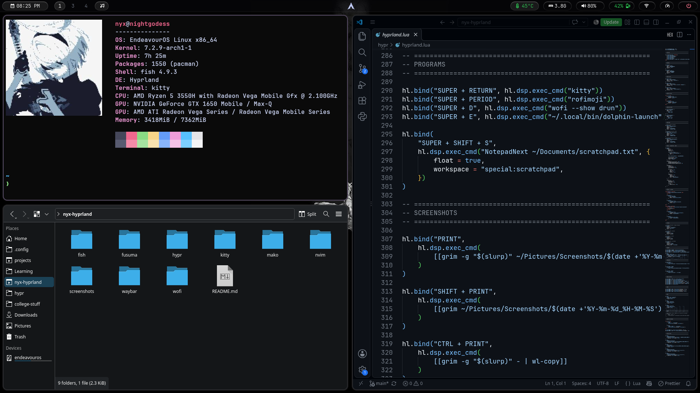

# Nyx Hyprland

Nyx is my personal Hyprland configuration for EndeavourOS, built from the way I actually use my desktop.

I wanted a setup that stayed out of my way while programming and working in the terminal, so most of the configuration is intentionally focused on keyboard-driven workflows, quick navigation, useful shortcuts, and minimal visual distractions.

The choices here aren't meant to be universal recommendations or a showcase of every Hyprland feature. If something exists in Nyx, there's usually a reason behind it — whether it's something that makes a daily workflow faster, solves a problem I had, or simply makes the desktop feel better to use.

It's also a place where I experiment. As I learn more about Linux, shell scripting, Git, and systems programming, the configuration changes with me.

## Screenshot



## Components

### Desktop

- Hyprland
- Waybar
- Hyprlock
- Hypridle

### Applications

- Kitty
- Dolphin
- Wofi
- Notepad Next

### Utilities

- rofimoji
- eza

### Shell

- Fish
- Starship

### Theme

- Catppuccin Mocha

## Keybinds

### Applications

- Launcher (Wofi): `SUPER + D`
- Terminal (Kitty): `SUPER + Return`
- File Manager (Dolphin): `SUPER + E`
- Scratchpad: `SUPER + SHIFT + S`
- Emoji Picker: `SUPER + .`

### Window Management

- Fullscreen: `SUPER + F`
- Kill Active Window: `SUPER + SHIFT + Q`
- Toggle Floating: `SUPER + V`
- Move Window: `SUPER + Mouse1`
- Resize Window: `SUPER + Mouse2`

### Navigation

- Focus Window: `SUPER + Arrow Keys`
- Workspace Switch: `SUPER + 1-0`
- Move Window to Workspace: `SUPER + SHIFT + 1-0`

### Touchpad Gestures

- 3-finger horizontal swipe: Switch workspace
- 3-finger swipe down: Minimize active window
- 3-finger swipe up: Restore minimized window
- 4-finger swipe down: Open scratchpad

### Screenshots

- Area Screenshot: `Print`
- Full Screenshot: `SHIFT + Print`
- Area Screenshot to Clipboard: `CTRL + Print`

## Features

- Lua-based Hyprland configuration
- Rounded corners and blur
- Catppuccin Mocha theme
- Custom heliotrope window borders
- Waybar integration
- Workspace navigation and touchpad gestures
- Custom wallpaper loader
- Hyprlock + Hypridle integration
- Fish + Starship terminal workflow
- eza with custom styling
- GUI scratchpad for temporary notes and text
- Emoji picker with clipboard integration
- Screenshot and clipboard workflow
- Tablet support

## Installation

Nyx is intended for a Hyprland/Wayland system. Install the applications and utilities used by the configuration, then copy the configuration directories into `~/.config`.

### Dependencies

Nyx uses the following applications and utilities:

- Hyprland
- Waybar
- Kitty
- Fish
- Hyprlock
- Hypridle
- Mako
- Fusuma
- awww
- Wofi
- eza
- bat
- Starship
- zoxide
- playerctl
- NetworkManager
- WirePlumber
- power-profiles-daemon
- grim
- slurp
- wl-clipboard
- brightnessctl
- libnotify
- pavucontrol
- wlogout
- hyprsunset
- rofimoji
- Dolphin
- VS Code
- Notepad Next
- Neovim

Some of these are only used by specific features or shortcuts. For example, `wlogout` is used by the power menu in Waybar, `playerctl` is used by the music widget, and `rofimoji` is used by the emoji picker.

### Install

Clone the repository:

```bash
git clone git@github.com:ChitranshAherwar/nyx-hyprland.git
cd nyx-hyprland
```

Copy the configuration directories into `~/.config`:

```bash
cp -r hypr waybar kitty fish wofi mako fusuma nvim ~/.config/
```

Make the custom scripts executable:

```bash
chmod +x ~/.config/hypr/scripts/*
chmod +x ~/.config/waybar/scripts/*
```

Restart Hyprland or reload the configuration:

```bash
hyprctl reload
```

### Personal Configuration

Nyx contains a few machine-specific and personal settings that may need to be changed when using it on another system.

- **Monitors:** Monitor names, resolutions, positions, and workspace assignments are defined in `hypr/hyprland.lua`.
- **Wallpapers:** Wallpaper paths are based on the user's home directory and wallpaper location.
- **Dolphin launcher:** `SUPER + E` uses `~/.local/bin/dolphin-launch`, which is not included in this repository.
- **Scratchpad:** The scratchpad opens `~/Documents/scratchpad.txt`.
- **Fish aliases:** Some aliases are personal conveniences and are not required by Nyx. For example, `popww` points to a personal script for launching a game.
- **Applications:** Some keybinds expect applications such as VS Code, Dolphin, and Notepad Next to be installed.
- **Wallpaper state:** `hypr/current_wallpaper` stores the currently selected wallpaper path.
- **Transparency:** The transparency toggle is currently disabled because changing window opacity caused focus issues. If you want to experiment with it, adjust the opacity values in the relevant script/configuration.
- **Tablet mode:** The tablet configuration assumes the display `eDP-1` and may need to be changed for another machine. Tablet mode is for drawing tablet.
- **Transparency:** Transparency is currently disabled because translucent windows made it harder to focus on the screen. The opacity configuration is still present if you want to experiment with transparency again.

Nyx is a personal configuration, so some paths, applications, monitor names, and aliases will need to be adapted to the system it is installed on.

## Notes

Nyx started as a backup of my Hyprland configuration while migrating from i3wm.

It gradually became something more: a living record of my Linux journey, my experiments with shell scripting and Git, and the little pieces of automation and customization that make my desktop feel like mine.

The configuration changes as I do. Some things get polished. Some get removed. Some survive purely because they're cool.

This repository is both a backup and a playground.

If something breaks, it was probably working five minutes ago.
